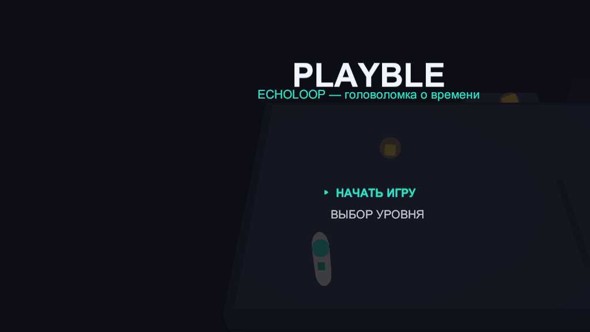
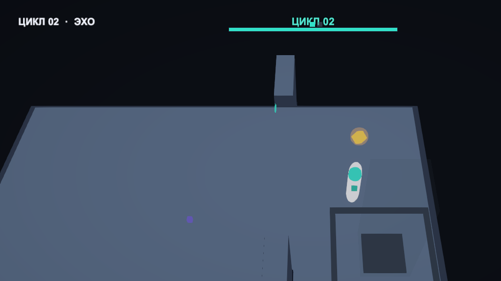
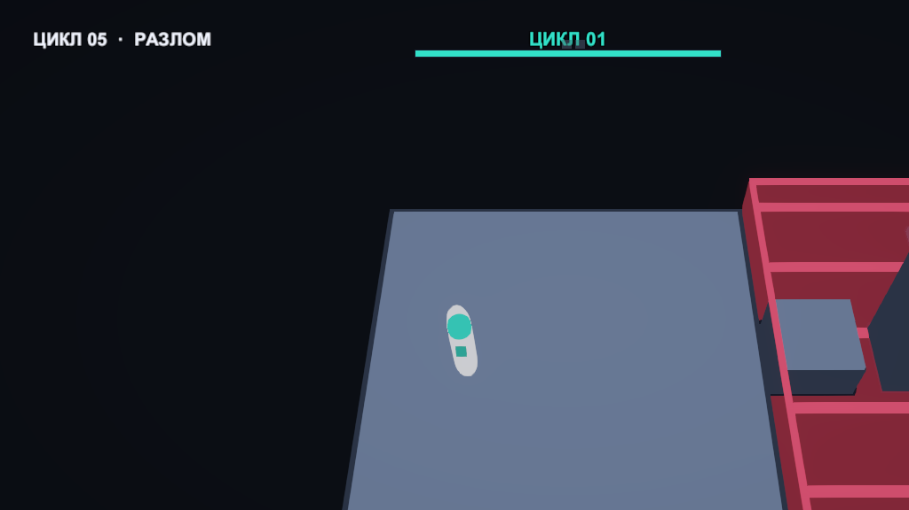
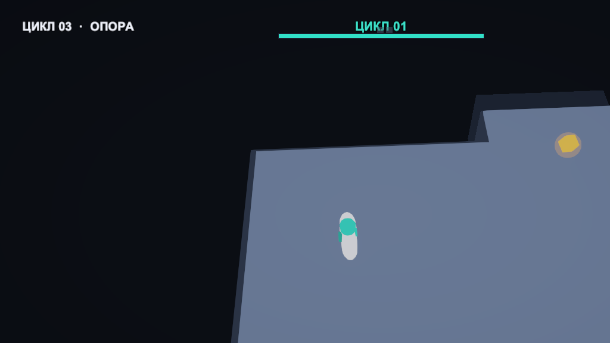
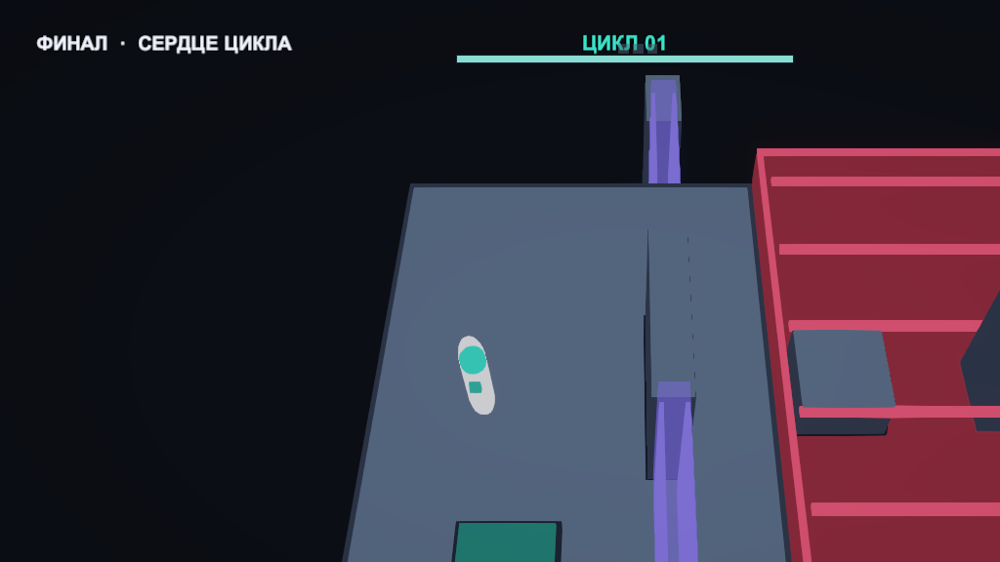

# ECHOLOOP

Головоломка о времени на Unity 6 + URP.

Петля длится несколько секунд. Когда она кончается, мир сбрасывается — но **эхо ваших
прошлых проходов остаётся и повторяет записанные движения**. Эхо твёрдое: на него можно
встать, оно держит нажимные плиты и открывает врата. Осколки переживают петлю, поэтому
уровень сначала «разведывается», а потом проходится начисто — с тремя собственными копиями
в подмоге.



## Как играть

| Клавиша | Действие |
|---|---|
| `W A S D` / стрелки | движение |
| `Space` | прыжок |
| `Esc` | пауза |
| `R` | перезапуск уровня |
| `W` / `Space` в меню | навигация |

Геймпад поддерживается наравне с клавиатурой.

### Правило, на котором держится игра

> Точка, где нужно встать эхо, всегда достижима обычным ходом.
> То, что эхо открывает, недостижимо без него.

Это единственное правило дизайна уровней, и оно же — главная причина, по которой
головоломки не зацикливаются. Тесты ниже проверяют его следствия автоматически.

## Что в репозитории

- **8 уровней** с прогрессией: движение → эхо-плита → эхо-платформа → две двери →
  опасности → композиция → экзамен → финал.
- **0 бинарных ассетов**: вся геометрия, все материалы и весь звук генерируются кодом.
- **26 EditMode-тестов**, которые проверяют данные уровней на проходимость.

### Скриншоты

| | |
|---|---|
|  |  |
| Осколок собран, эхо держит плиту, врата растворились | Прыжок с эхо через пропасть |
|  |  |
| Уступ, недостижимый без эхо как платформы | «Сердце цикла»: три плиты и разлом |

## Архитектура

```
Assets/Scripts/
├── Core/        точка входа, автомат приложения, палитра, кэш материалов, прогресс
├── Loop/        тактовый таймер петли, лента записи, эхо-тела
├── Player/      контроллер персонажа, ввод, камера
├── World/       описание уровня, база уровней, плиты, врата, осколки, выход, опасности
├── UI/          HUD, меню, фабрика UGUI
└── Audio/       синтез звука
Assets/Editor/   генератор сцены, сборщик standalone
Assets/Tests/    EditMode-тесты
```

### Решения, которые стоит посмотреть

**Уровень — это данные, а не сцена.** `LevelDefinition` описывает уровень списками
опор, плит, врат и осколков; `LevelRuntime.Build()` собирает геометрию в рантайме.
Добавление уровня — это один блок кода, а не редактирование `.unity`. Побочный эффект:
в репозитории нет конфликтов слияния на сценах, а `.unity` файл не может разъехаться.

**Петля живёт по целочисленным тикам, а не по кадрам.** `LoopClock` — единственный
источник времени, 60 тиков в секунду. Зависший кадр не сдвигает петлю и не ломает
синхронизацию записи. Порядок тика зафиксирован в одном месте:

1. эхо проигрывают прошлое,
2. игрок делает шаг,
3. мир реагирует на новое расположение тел,
4. поза игрока записывается в ленту.

**Эхо проигрывает запись, а не пересимулирует физику.** `LoopTape` хранит позу на
каждом тике плотным массивом без аллокаций. Поэтому эхо не «расползается» из-за
накопления ошибок и воспроизводит ровно то, что сделал игрок, включая промах.
Эхо при этом остаётся твёрдым телом — встать можно.

**Нажатие плит считается вручную, а не через PhysX.** `PressurePlate` сравнивает AABB
своей зоны с габаритами тел. Это исключает зависимость от `Physics.autoSyncTransforms`
и делает правило «плите всё равно, кто на ней стоит — игрок или эхо» очевидным
в коде, а не следствием настройки движка.

**Материалы кэшируются, анимируемые параметры квантуются.** `MaterialLibrary` создаёт
материал по ключу из параметров. Без квантования пульсация пересоздавала бы материал
каждый кадр; `MaterialLibrary.Quantize` — это дешёвая защита от такого класса утечек.

**Звук синтезируется в памяти.** `Synth` генерирует короткие эффекты и фоновый дрон
прямо в `AudioClip` при старте. Аудиофайлов в проекте нет вообще.

**Сцена генерируется кодом.** `PlaybleSetup` создаёт камеру, свет, постпроцессинг
и точку входа, `PlaybleBuilder` собирает игру. Обе задачи доступны и из меню Unity
(`Playble/…`), и из командной строки.

## Тесты

Уровни заданы числами, и большую часть ошибок в них не видно глазами: плита в стене,
выход в воздухе, дверь, которую можно обойти сбоку, нехватка времени на петлю.
Это проверяет `LevelValidationTests`:

```csharp
[Test] EveryLevel_GateCannotBeWalkedAround()      // стена непрерывна по всей ширине площадки
[Test] EveryLevel_PlatesAreFreeAndSupported()    // плита не в блоке и не в опасной зоне, под ней пол
[Test] EveryLevel_ShardsAreReachableAndNotBuried()
[Test] EveryLevel_LoopIsLongEnoughForFinalRun()  // маршрут влезает в длину петли
[Test] EveryLevel_HazardIsVisibleAndNotFloating()
```

`LoopSystemTests` проверяет саму механику: лента записи и дописывание хвоста при смерти,
лимит архива эхо, правило «плита нажата любым телом», «врата открываются только когда
нажаты все связанные плиты», одноразовый сбор осколка.

Тесты нашли четыре настоящих бага в дизайне уровней — плиту в пропасти на финале и три
незакрытых обхода вокруг дверей.

### Запуск

```powershell
unity test .\Playble_Ads --editor-version 6000.0.73f1 --mode EditMode
```

## Сборка

```powershell
# Windows
unity build .\Playble_Ads --editor-version 6000.0.73f1 `
    --target StandaloneWindows64 --output-path .\Build\Windows\PlaybleEchoLoop.exe

# Linux
unity build .\Playble_Ads --editor-version 6000.0.73f1 `
    --target StandaloneLinux64 --output-path ./Build/Linux/PlaybleEchoLoop.x86_64
```

Сборка `Build/` в репозиторий не попадает — она воспроизводится за пару минут.

## Отладка

Уровни открываются напрямую, без меню:

```powershell
.\Build\Windows\PlaybleEchoLoop.exe -level 5
```

## Требования

- Unity `6000.0.73f1` (Unity 6 LTS)
- URP 17, новый Input System

Проект создан на пустом URP-шаблоне; содержимое `Assets/Scripts`, `Assets/Editor`
и `Assets/Tests` написано с нуля.